# 风格图鉴

15 套风格的真实渲染产物，1080×1440（3:4）。**全部是用同一篇真实内容跑出来的成图，不是设计稿**
——文案取自一篇「Agent 工程必读的 5 份资料」的图文，用来对比不同风格下的排版差异。

封面和内容卡左右对照：左边是 `cover` / `poster`（负责让人点进来），右边是正文 block
（负责讲清内容）。两者的版式逻辑是分开的，详见下面的「封面 vs 内容卡」。

---

## 已启用

### `01` 杂志编辑风

米白纸底 + 思源宋体大字标题 + 朱红强调，大留白贴底引语块。信息密度最高的排法，适合有干货要讲的主题。

<table>
<tr>
<td>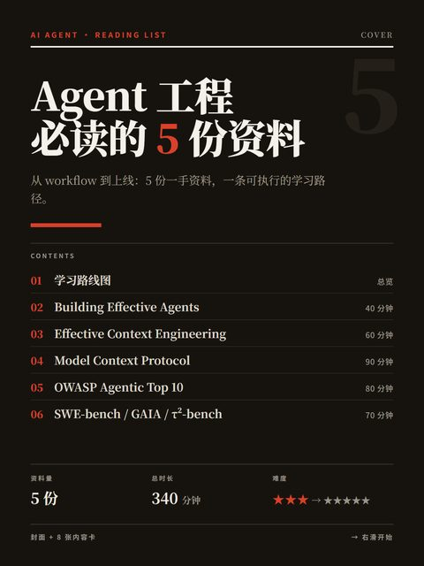</td>
<td>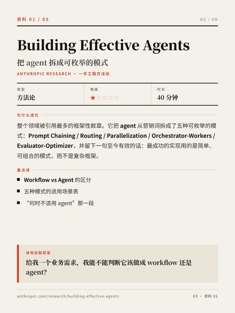</td>
</tr>
<tr><td align="center">cover 索引封面</td><td align="center">resource 资料详解</td></tr>
</table>

### `06` 插画风

奶油底 + 珊瑚橙 + 大圆角，卡片顶部配扁平矢量插画。亲和力最强的一套。

<table>
<tr>
<td>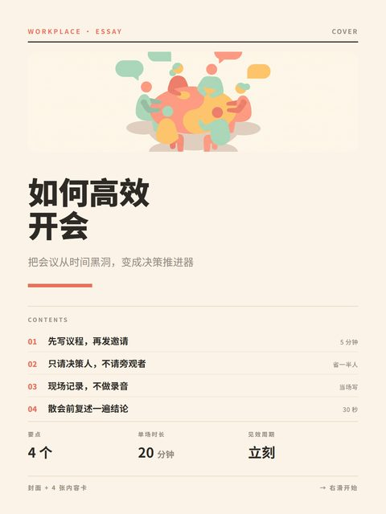</td>
<td>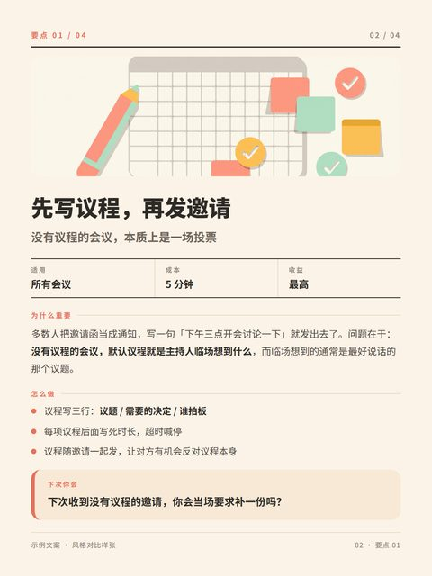</td>
</tr>
<tr><td align="center">封面 + 插画带</td><td align="center">resource 资料详解</td></tr>
</table>

### `10` 干货大字报

深炭灰底 + 米白巨标题 + 朱红色块强调 + 胶片噪点。**纯文字海报**，不依赖插画，中文绝对不会出错。

<table>
<tr>
<td>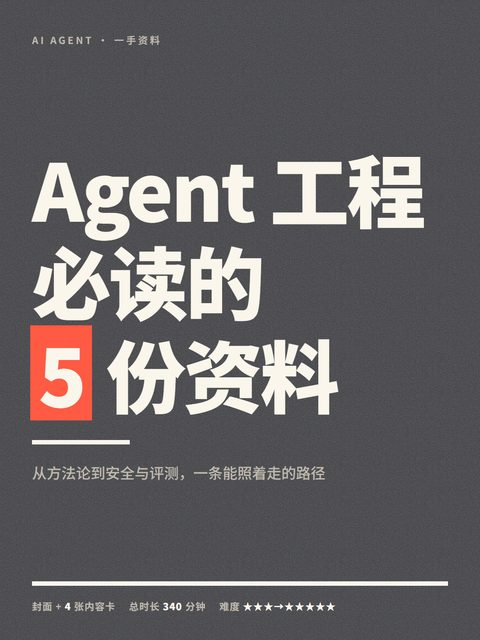</td>
<td>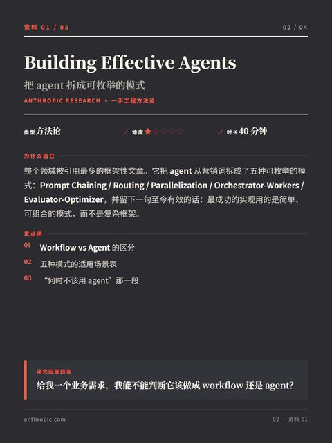</td>
</tr>
<tr><td align="center">poster 拦截封面</td><td align="center">resource 资料详解</td></tr>
</table>

### `11` 白底撞色巨字

纯白底 + 黑巨标题 + 朱红色块撞色。最干净的一套，缩略图里黑字朱块的对比最抓眼。

<table>
<tr>
<td>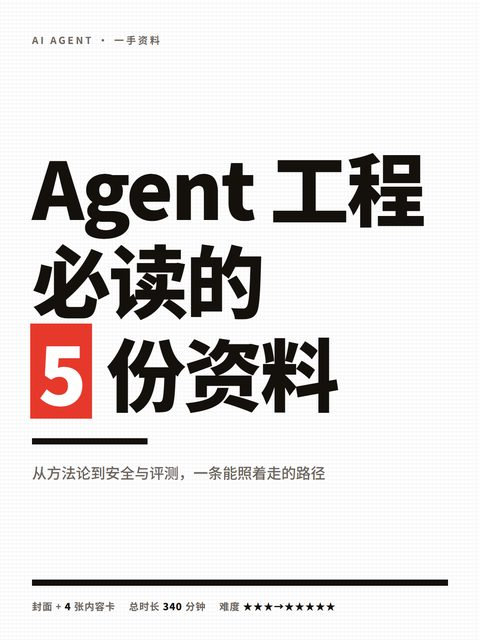</td>
<td>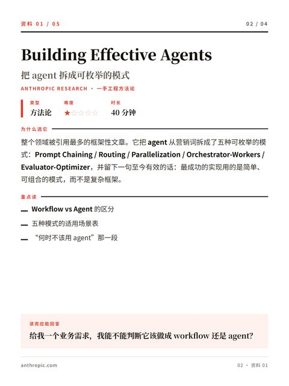</td>
</tr>
<tr><td align="center">poster 拦截封面</td><td align="center">resource 资料详解</td></tr>
</table>

### `12` 活力橙

橙色渐变底 + 白色巨标题 + 暖光晕。纯文字海报里最有情绪的一套，适合轻松向的话题。

<table>
<tr>
<td>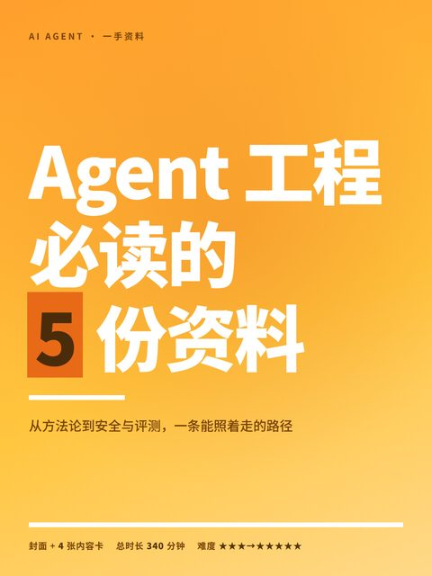</td>
<td>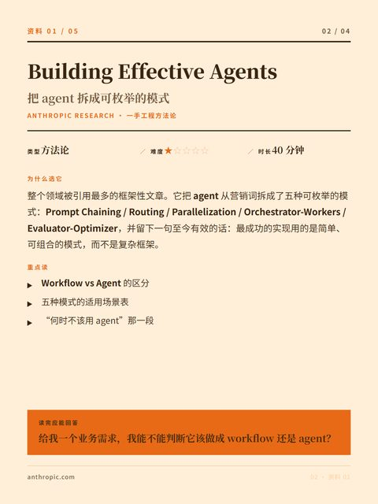</td>
</tr>
<tr><td align="center">poster 拦截封面</td><td align="center">resource 资料详解</td></tr>
</table>

### `13` 毛绒潮玩

顶部毛绒 3D 角色插画带 + 薄荷奶油底 + 墨绿巨标题。冷调、圆润、不严肃，适合轻松科普。

<table>
<tr>
<td></td>
<td>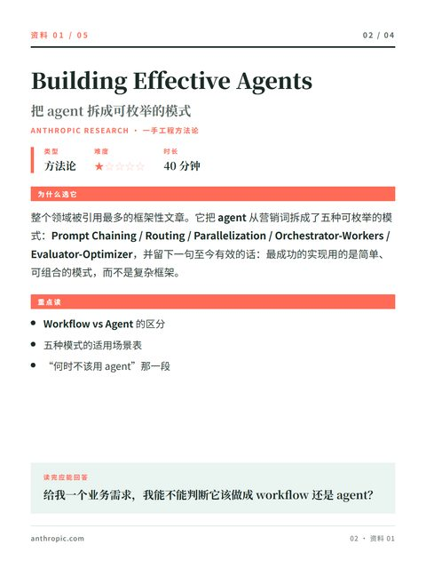</td>
</tr>
<tr><td align="center">poster + 插画带</td><td align="center">resource 资料详解</td></tr>
</table>

### `14` 动漫工位

顶部 2.5D 动漫插画带 + 暖杏奶油底 + 墨棕巨标题 + 珊瑚橙强调。暖调，适合成长/学习向。

<table>
<tr>
<td>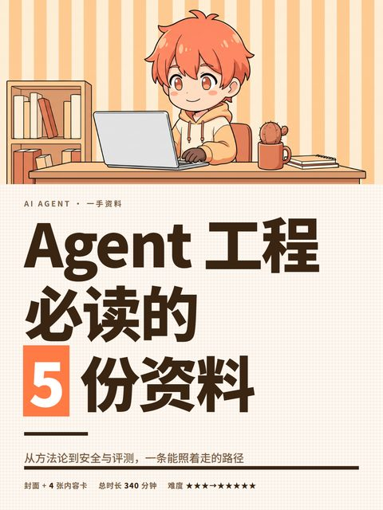</td>
<td>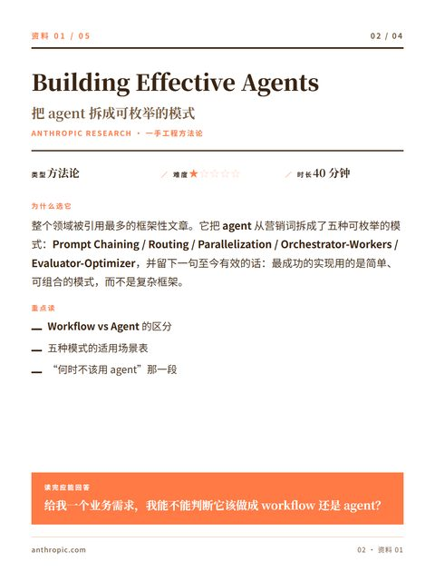</td>
</tr>
<tr><td align="center">poster + 插画带</td><td align="center">resource 资料详解</td></tr>
</table>

### `15` 微缩立体书

顶部微缩景观插画带 + 深青底 + 金黄巨标题。**明度压得最狠的一套**，缩略图里最出片。

<table>
<tr>
<td>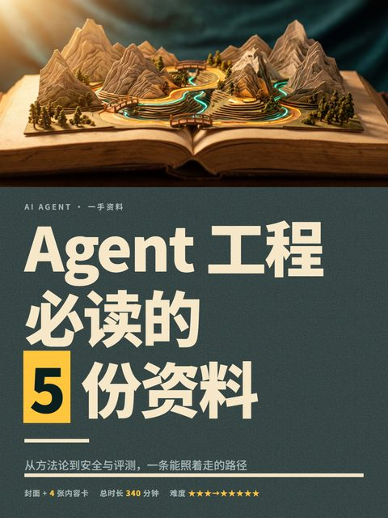</td>
<td>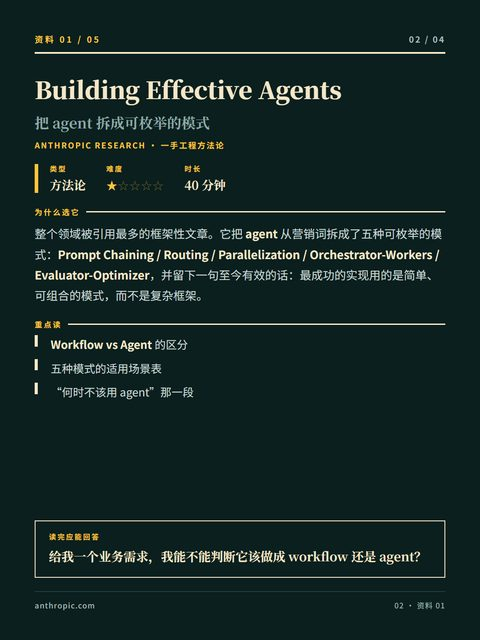</td>
</tr>
<tr><td align="center">poster + 插画带</td><td align="center">resource 资料详解</td></tr>
</table>

---

## 候选

这三套是针对「版式太像 PPT」重做的，还没正式启用。可以用，但不建议直接发。

### `07` 大字报风

高饱和纯色封面 + 反白巨型字，标题压色块，要点用 01/02 序号。

<table>
<tr>
<td>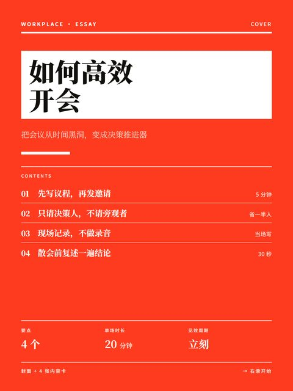</td>
<td>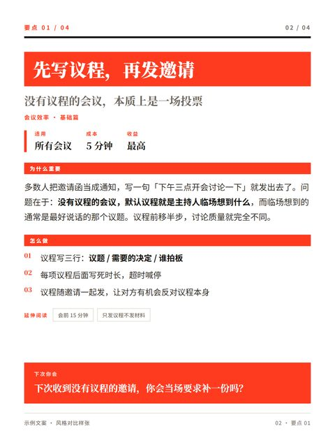</td>
</tr>
<tr><td align="center">封面</td><td align="center">内容卡</td></tr>
</table>

### `08` 拼贴风

米黄旧纸底 + 橘红标题块，元信息压成一行短句。

<table>
<tr>
<td>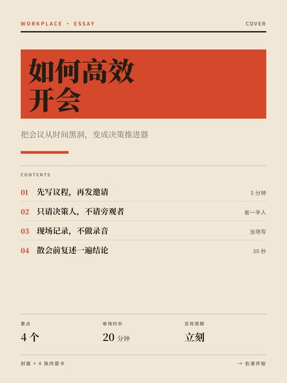</td>
<td>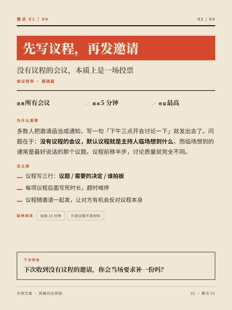</td>
</tr>
<tr><td align="center">封面</td><td align="center">内容卡</td></tr>
</table>

### `09` 手记风

米白笔记纸 + 楷体 + 荧光黄高亮问句。

<table>
<tr>
<td>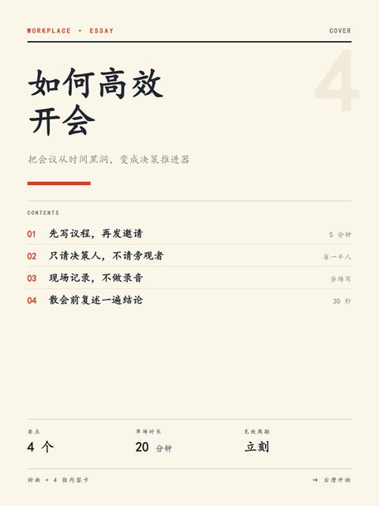</td>
<td>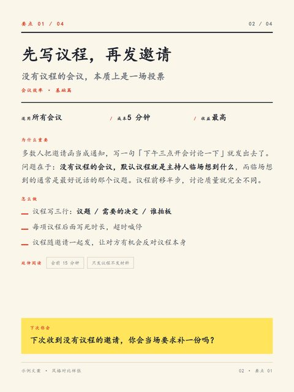</td>
</tr>
<tr><td align="center">封面</td><td align="center">内容卡</td></tr>
</table>

---

## `02`–`05` 已作废

这四套被判掉的原因是同一个：**版式太像 PPT / 报表**。留图是为了说明新风格为什么要避开那些做法，
token 文件也留着当记录，但**状态是作废，编号不复用，不要拿去出图**。

具体指这些特征：

- 三栏/多栏等分网格，标题在上、正文在下的标准对称结构
- 圆角矩形卡片 + 阴影 + 图标配文字，一行一个 item
- 图标/序号居左、说明文字居右的表格式排布
- 看起来像「一页幻灯片」而不是「一张可以截图保存的图」

### `02` 商务简报风 — 作废

冷白底 + 深藏青封面 + 铜金强调，全无衬线，描边引语框。

<table><tr><td>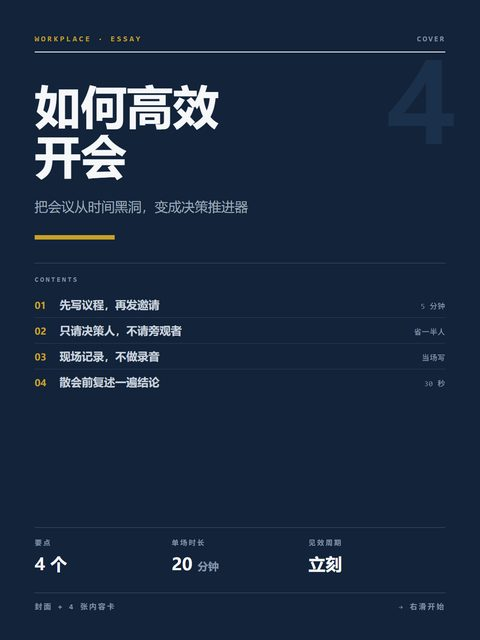</td></tr></table>

### `03` 极简黑白风 — 作废

纯白底 + 纯黑封面 + 超粗黑体，荧光绿单强调，细线引语。

<table><tr><td>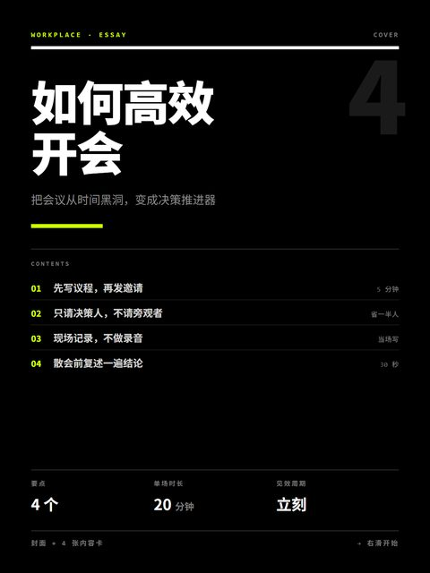</td></tr></table>

### `04` 科技冷光风 — 作废

深空底全篇 + 霓虹青 + 等宽标签 + 圆角描边卡片。

<table><tr><td>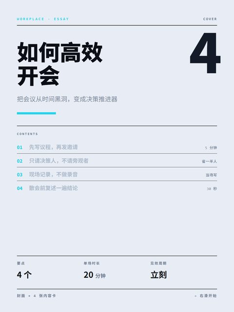</td></tr></table>

### `05` 暖调手账风 — 作废

米杏底 + 浅色封面 + 赭石强调，大圆角柔和字重。

<table><tr><td>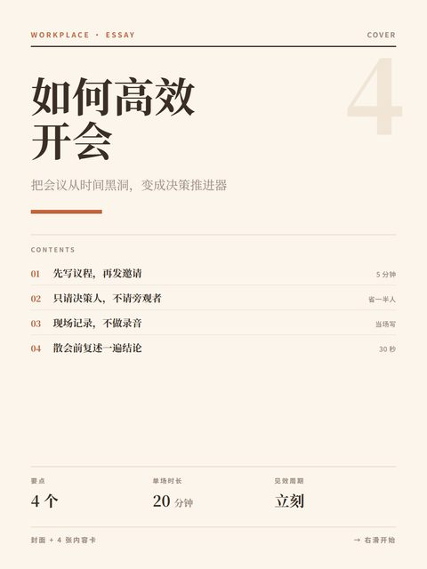</td></tr></table>

---

## 封面 vs 内容卡：两套逻辑

同一个 `block` 在封面和正文里的职责不同，这是这套设计里最容易混的一处：

| | `cover` | `poster` |
|---|---|---|
| 职责 | 索引，告诉读者这套有几张、分别讲什么 | 拦截，只让人停下来点 |
| 元素数 | 不限（目录 + 统计 + 提示） | **≤5**：眉题 / 标题 / 色条 / 副标题 / 标签条 |
| 标题字号 | 96–100px | **168–178px**，靠字号本身压住画面 |
| 强调色 | 允许多处 | **只给一处**（`blk` 色块或 `hi` 变色，二选一） |
| 底色 | 纸底即可 | 走极端明度，且要带质感（`posterTexture`） |

判断标准：**这张图的任务是「告诉人里面有什么」还是「让人点进来」**。
`10`–`15` 用 `poster`，`01`/`06`/`07`–`09` 用 `cover`。

## 怎么选

| 你想要 | 选 |
|---|---|
| 专业、信息密度高、像杂志 | `01` |
| 亲和、可爱、不严肃 | `13` |
| 缩略图里最抓眼、对比最强 | `11` 或 `15` |
| 暖、有生活感 | `14` 或 `12` |
| 不想依赖插画素材、中文零风险 | `10`、`11`、`12` |
| 深夜质感、暗调、显得硬核 | `15` |

`10`–`15` 六套都同时支持 `poster` 和 `resource`/`items`/`qa`，
所以能整套出图（封面 + 多张内容卡），不用拼。

> 注：`13` 的示例图用的是原生 21:9 横带素材。早期版本曾用 3:4 竖图硬裁成横带，
> 玩偶被放得过大、顶部留白比例失衡——对比之下原生横带明显更好。